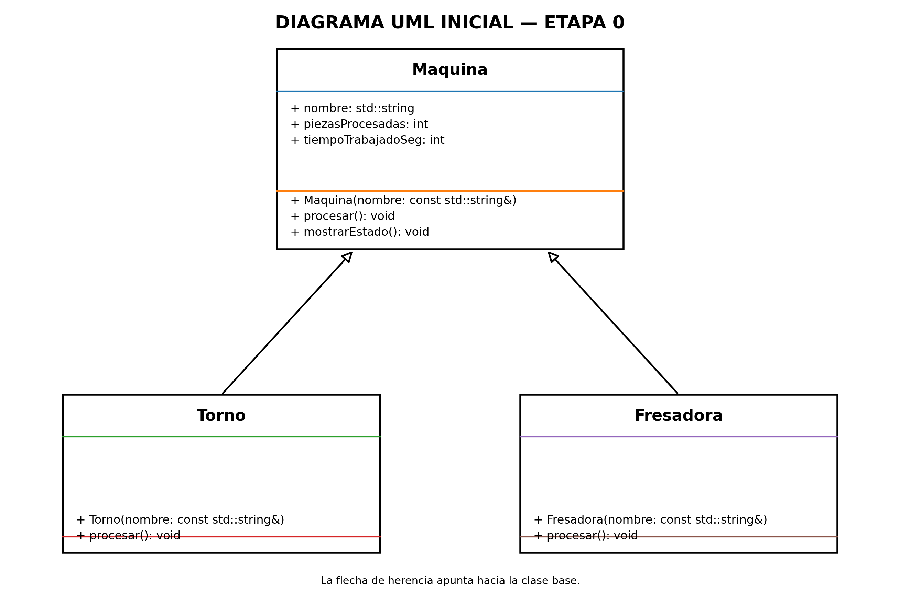

# Práctica Unidad IV: La evolución de una máquina

Programación Orientada a Objetos · Ingeniería Mecatrónica · Tercer semestre

Llena cada espacio conforme avances en las fases de [PRACTICA.md](PRACTICA.md).

## Fase 1. Entender el problema

**1.1 El problema con mis propias palabras**

El problema consiste en desarrollar un programa que permita controlar diferentes máquinas de una planta de manufactura. Cada máquina debe procesar piezas, registrar su tiempo de trabajo y llevar un control de su producción. El objetivo es mejorar la clase Maquina para evitar errores y lograr que todas las máquinas trabajen correctamente mediante la programación orientada a objetos.

**1.2 Reglas que siempre deben cumplirse en una máquina** (escribe al menos tres)
1. El nombre de la máquina no debe estar vacío.
2. La cantidad de piezas procesadas nunca debe ser negativa.
3. El tiempo trabajado y el tiempo de cada ciclo deben ser valores válidos y no negativos; el tiempo de ciclo debe ser mayor que cero.

**1.3 ¿Quién más usa la clase `Maquina`? ¿Qué podría salir mal si otro equipo crea una máquina nueva sin conocer tus reglas?**

La clase Maquina es utilizada por todas las clases derivadas, como Torno y Fresadora, además de la clase ControlDeLinea. Si otro equipo crea una máquina sin conocer las reglas, podría modificar incorrectamente los datos, registrar mal las piezas o calcular tiempos incorrectos, provocando errores en los reportes de producción.

## Fase 2. Diseñar la solución

**2.1 Diagrama inicial (Etapa 0)**

**2.2 Diagrama final (Etapa 9)**

**2.3 ¿Qué cambió entre los dos diagramas?**

| Elemento | Etapa 0 | Etapa 9 | Etapa que lo cambió |
| --- | --- | --- | --- |
| Visibilidad de los atributos de `Maquina` | _____ | _____ | _____ |
| `procesar()` | _____ | _____ | _____ |
| `tiempoCicloSeg()` | _____ | _____ | _____ |
| Destructor de `Maquina` | _____ | _____ | _____ |
| ¿Se pueden crear objetos `Maquina`? | _____ | _____ | _____ |
| Relación `ControlDeLinea` - `Maquina` | _____ | _____ | _____ |
| Relación `Torno` - `Motor` | _____ | _____ | _____ |
| Relación `BandaTransportadora` - `Motor` | _____ | _____ | _____ |

## Fase 3. Implementar

**3.0 Etapa 0. Una máquina sin reglas**

a) ¿Qué imprime `ejecutarTurno()` para el torno y la fresadora? ¿Por qué no imprime "torneando" ni "fresando"?

Imprime "procesamiento generico" para ambas máquinas porque el método procesar() no es virtual. Por eso se ejecuta el método de la clase base Maquina y no el de las clases derivadas.
b) ¿Por qué el torno acumula 65 s y no 135 s?

Porque al llamar directamente al torno suma 45 segundos, pero dentro de ejecutarTurno() realiza dos ciclos genéricos de 10 segundos cada uno. Por eso acumula 65 segundos en total.

**3.1 Etapa 1. Invariantes y constructores explicit**

a) ¿Qué regla de la sección 1.2 rompió `torno.piezasProcesadas = -5;`?

Porque así se evita que otras clases modifiquen directamente los datos y provoquen errores en el funcionamiento de las máquinas.

b) ¿De dónde salió la máquina "Fantasma"? ¿Qué hizo el compilador sin que se lo pidieras?

Permiten que las clases derivadas registren piezas y agreguen tiempo de trabajo sin acceder directamente a los atributos privados.

c) ¿Qué tuviste que cambiar en `Torno` y `Fresadora` y por qué?

Permiten consultar la información de una máquina de forma segura, sin modificar sus valores.

**3.2 Etapa 2. Virtual y override**

a) La fresadora acumula 180 s, pero reporta 360 pzas/h. ¿Por qué un cálculo usó 60 s y el otro 10 s?

Porque el procesamiento de la fresadora utiliza ciclos de 60 segundos, mientras que el cálculo de capacidad todavía utiliza los 10 segundos definidos en la clase base Maquina. Esto provoca que los tiempos no coincidan.

b) ¿Tu compilador mostró alguna advertencia antes de usar `override`? ¿Qué mensaje dio después de agregar `override`?

Antes de utilizar override, el compilador podía aceptar una declaración incorrecta sin detectar que no se estaba sobrescribiendo el método esperado. Al agregar override, si la firma no coincide, el compilador muestra un error indicando que el método no sobrescribe ninguna función de la clase base.

**3.3 Etapa 3. La línea de producción**

a) ¿Por qué la línea procesó todo como "generico" si `procesar()` ya es virtual?

Porque se utilizaron objetos de tipo Maquina almacenados por valor en un vector. Esto provocó que se perdiera la información específica de las clases derivadas, por lo que se ejecutó el comportamiento de la clase base.

b) ¿Por qué el torno y la fresadora originales quedaron con 0 piezas?

Porque la línea trabajó con copias de los objetos originales. Los cambios realizados durante el procesamiento afectaron únicamente a las copias almacenadas en el vector, no a las máquinas originales.

c) La relación entre `ControlDeLinea` y `Maquina`, ¿es composición o agregación? ¿Por qué?

Es agregación porque ControlDeLinea utiliza máquinas que fueron creadas fuera de la clase. Las máquinas pueden existir independientemente y no dependen de ControlDeLinea para su creación o destrucción.

**3.4 Etapa 4. Destructores**
| Momento | Mensajes de destrucción que aparecieron |
| --- | --- |
| `delete temporal;` sin destructor virtual | `Destruyendo Maquina` |
| `delete temporal;` con destructor virtual | `Destruyendo Torno` → `Destruyendo Motor` → `Destruyendo Maquina` |
| Al terminar `main` (torno y fresadora) | `Destruyendo Maquina` → `Destruyendo Torno` → `Destruyendo Motor` → `Destruyendo Maquina` |

a) ¿Qué advertencia mostró el compilador? ¿Por qué decimos que ya te estaba avisando del problema?

El compilador mostró una advertencia indicando que eliminar un objeto de una clase polimórfica mediante un destructor no virtual podía provocar un comportamiento indefinido. Nos estaba avisando que el objeto derivado podía no destruirse correctamente.

b) ¿Por qué el torno de `main` sí se destruyó completo aunque el destructor no fuera virtual? ¿A qué máquina corresponde el primer "Destruyendo Maquina" después de "Fin de main"?

Porque el torno de main fue creado directamente como un objeto de tipo Torno y no se eliminó mediante un puntero a Maquina. Al terminar el programa se ejecutaron sus destructores en el orden correspondiente. El primer mensaje "Destruyendo Maquina" después de "Fin de main" corresponde a la Fresadora, que fue creada después del Torno.

**3.5 Etapa 5. La clase abstracta**

a) Copia los mensajes de error y explica con tus palabras qué dice cada uno.

El compilador indicó que no se podía crear un objeto de tipo Pulidora porque no tenía implementado el método virtual puro procesar(). También indicó que no se podía crear un objeto de tipo Maquina porque es una clase abstracta y tiene métodos virtuales puros sin implementar.

b) ¿Por qué es mejor este error de compilación que el comportamiento "generico" de antes?

Porque el compilador evita que se creen máquinas incompletas o sin un comportamiento definido. Así se detectan los errores antes de ejecutar el programa y se garantiza que cada máquina implemente sus funciones.

**3.6 Etapa 6. El contrato que el compilador no ve**

a) ¿Qué partes del contrato violó `InspeccionVisual`?

[Inserta aquí tu respuesta]

b) ¿Por qué el compilador no lo detectó?

[Inserta aquí tu respuesta]

c) ¿Qué pasaría si el próximo equipo tampoco lee el comentario del contrato?

[Inserta aquí tu respuesta]

**3.7 Etapa 7. La base hace cumplir el contrato**

a) ¿Cómo puede una clase derivada sobrescribir un método que es privado en la base?

[Inserta aquí tu respuesta]

b) ¿Qué ocurre ahora con una máquina cuyo tiempo de ciclo es 0? Compáralo con la Etapa 6.

[Inserta aquí tu respuesta]
a aquí tu respuesta]
c) ¿Por qué la línea ignoró el "atajo" del torno, pero la llamada directa no? ¿Cómo corregiste el diseño?

[Inserta aquí tu respuesta]

**3.8 Etapa 8. Herencia mal usada**

a) Da al menos dos razones por las que `BandaTransportadora : public Motor` es un error de diseño.

[Inserta aquí tu respuesta]

b) La relación entre `BandaTransportadora` y `Motor`, ¿es composición o agregación? ¿Por qué?

[Inserta aquí tu respuesta]

**3.9 Etapa 9. La librería y la prueba final**

a) Después de agregar la `Cortadora`, ¿qué archivos mostró `git status`? ¿Cuántos archivos de la librería tuviste que modificar?

[Inserta aquí tu respuesta]

b) ¿Qué pasó al escribir `-lplanta` antes de `src/main.cpp`? ¿Por qué?

[Inserta aquí tu respuesta]

**3.10 Bitácora de dudas**

| # | Etapa | Duda | Cómo la resolví | Fuente |
| --- | --- | --- | --- | --- |
| 1 | _____ | _____ | _____ | _____ |
| 2 | _____ | _____ | _____ | _____ |
| 3 | _____ | _____ | _____ | _____ |

## Fase 4. Probar y mejorar

**4.1 Tabla de pruebas**

| # | Caso | Resultado esperado | Resultado obtenido | ¿Pasa? |
| --- | --- | --- | --- | --- |
| 1 | Máquina con nombre vacío | Excepción con mensaje claro | _____ | _____ |
| 2 | Reporte de una línea vacía | "La linea no tiene maquinas" | _____ | _____ |
| 3 | `agregar(nullptr)` | Devuelve `false` | _____ | _____ |
| 4 | Reporte antes de ejecutar el turno | 0 piezas, 0 s y capacidad calculada | _____ | _____ |
| 5 | Turno de 0 ciclos | Nada cambia | _____ | _____ |
| 6 | Torno con 3 ciclos | 3 piezas, 135 s, 80 pzas/h | _____ | _____ |
| 7 | Máquina con `tiempoCicloSeg()` igual a 0 | Excepción con mensaje claro | _____ | _____ |
| 8 | Máquina con `tiempoCicloSeg()` negativo | Excepción con mensaje claro | _____ | _____ |
| 9 | La misma máquina agregada dos veces | _____ | _____ | _____ |

**4.2 Bitácora de mejoras**

| # | Falla o mejora detectada | Qué cambié | Por qué |
| --- | --- | --- | --- |
| 1 | _____ | _____ | _____ |
| 2 | _____ | _____ | _____ |

Retos opcionales que intenté: _____

## Fase 5. Publicar en GitHub

**5.1 Enlace a mi fork**

[Inserta aquí el enlace a tu fork]

## Cierre y reflexión

**6.1 Errores que ya no pueden ocurrir**

| Error | Etapa en que apareció | Restricción que lo impide ahora | ¿Quién lo detecta: el compilador o el programa? |
| --- | --- | --- | --- |
| Contadores con valores inválidos | _____ | _____ | _____ |
| Máquina "fantasma" creada a escondidas | _____ | _____ | _____ |
| Método que no sobrescribe por un `const` | _____ | _____ | _____ |
| Máquinas copiadas y "rebanadas" | _____ | _____ | _____ |
| Destrucción incompleta | _____ | _____ | _____ |
| Máquina sin `procesar()` propio | _____ | _____ | _____ |
| Tiempo de ciclo inválido | _____ | _____ | _____ |
| Derivada que no registra sus piezas | _____ | _____ | _____ |

**6.2 ¿Cuál de los errores fue el más peligroso: el de compilación, la advertencia o el que compilaba sin problemas? ¿Por qué?**

[Inserta aquí tu respuesta]

**6.3 ¿Qué aprendiste en esta práctica?**

[Inserta aquí tu respuesta]

**6.4 ¿Qué cambiarías de tu proceso la próxima vez?**

[Inserta aquí tu respuesta]
